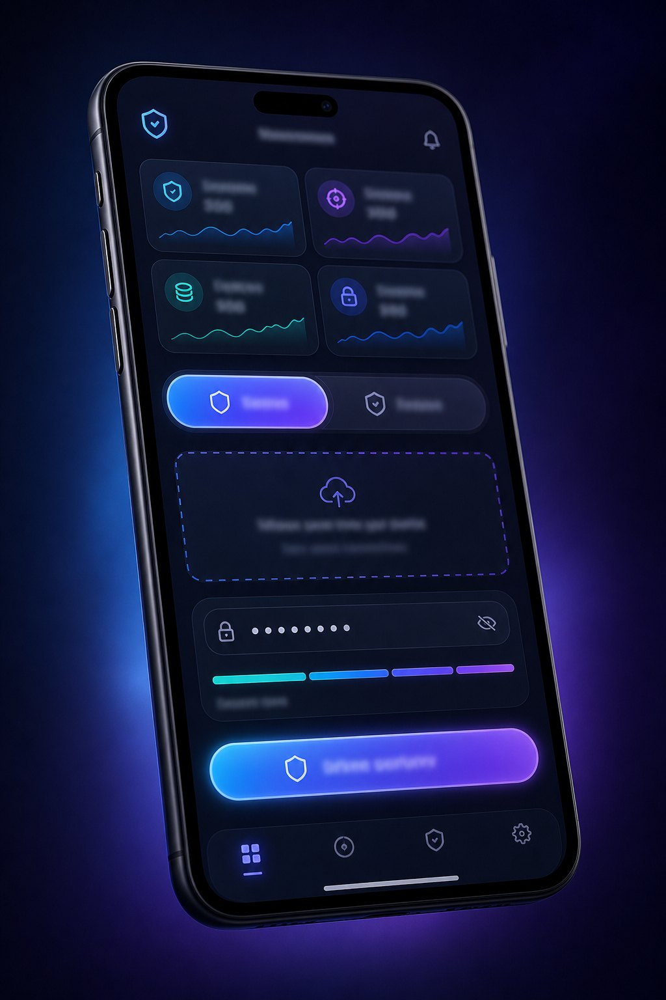

<div align="center">


# 🔐 LEXICON VAULT

### Complete User Guide & Documentation

**Version 1.0** · **Platform: Android** · **Category: File Security, Locking & Restoration**

`🔒 Lock & Encode` `🔓 Unlock & Restore` `📴 Local Processing` `🗝️ Password Protected`

**Lock. Encode. Protect.**
*Your Files. Your Password. Your Control.*

</div>

---

> [!IMPORTANT]
> **Two things you must never lose:**
> 1. **Your exact password** — character for character, including capitals and spaces.
> 2. **The complete protected pattern file** — not just the preview.
>
> Lexicon Vault has **no password recovery**. Neither item alone can restore your file. 🚫🔑

---

## 📚 Table of Contents

| # | Section | Jump |
|:--|:--------|:-----|
| 1 | Introduction & Philosophy | [↓](#1--introduction--philosophy) |
| 2 | Understanding Lexicon Vault | [↓](#2--understanding-lexicon-vault) |
| 3 | Application Features | [↓](#3--application-features) |
| 4 | Getting Started & Dashboard | [↓](#4--getting-started--dashboard) |
| 5 | How to Lock a File | [↓](#5--how-to-lock-a-file) |
| 6 | How to Unlock & Restore a File | [↓](#6--how-to-unlock--restore-a-file) |
| 7 | Copy-and-Paste Method | [↓](#7--copy-and-paste-method) |
| 8 | Password Management | [↓](#8--password-management--protection) |
| 9 | Activity History | [↓](#9--activity-history) |
| 10 | Security Information | [↓](#10--security-information) |
| 11 | Large File Processing | [↓](#11--large-file-processing) |
| 12 | File Selection & Storage | [↓](#12--file-selection--storage-management) |
| 13 | Cancelling an Operation | [↓](#13--cancelling-an-operation) |
| 14 | Troubleshooting | [↓](#14--troubleshooting) |
| 15 | Best Practices | [↓](#15--best-practices) |
| 16 | FAQ | [↓](#16--frequently-asked-questions) |
| 17 | Recommended File Organization | [↓](#17--recommended-file-organization) |
| 18 | Privacy Recommendations | [↓](#18--privacy-recommendations) |
| 19 | Quick Reference | [↓](#19--quick-reference) |
| 20 | Final Notes | [↓](#20--final-notes) |

---

## 1 · Introduction & Philosophy

Welcome to **Lexicon Vault** 🗄️ — a file protection and restoration application that lets you **lock your files with a personal password** and **restore them exactly when you need them**.

Lexicon Vault presents a simple interface built around two primary operations:

| Operation | What It Does | Icon |
|:----------|:-------------|:----:|
| **Lock & Encode** | Converts an original file into a protected **pattern** file | 🔒 |
| **Unlock & Restore** | Rebuilds the original file using the **exact** matching password | 🔓 |

The app processes files **locally**, applies **password-based protection**, and supports **large files** without loading the entire file into memory.

Whether you're protecting documents, images, videos, audio, archives, or other supported formats — the workflow stays the same. ✨

### 🧭 Main Philosophy

Lexicon Vault is built around three principles:

```text
   ┌──────────────┐     ┌──────────────┐     ┌───────────────────┐
   │  1. PRIVACY  │ ──▶ │ 2. SIMPLICITY│ ──▶ │ 3. FILE PROTECTION│
   └──────────────┘     └──────────────┘     └───────────────────┘
```

The application focuses on giving **you** control over your files and your passwords.

---

## 2 · Understanding Lexicon Vault

Lexicon Vault has **two operating modes**.

### 🔒 2.1 Lock Mode

Lock Mode converts an original file into a protected pattern.

**During this process:**

1. 🗂️ The user selects an original file.
2. 🔑 The user enters a personal password.
3. ⚙️ The application processes the file.
4. 🧬 The application generates a protected pattern.
5. 💾 The resulting pattern is saved for future restoration.


> [!NOTE]
> The original file remains **separate** from the generated pattern file. The **pattern file is the one you must keep** if you ever want to restore your original data later.

### 🔓 2.2 Unlock Mode

Unlock Mode restores a previously protected file.

**During this process:**

1. 🗂️ The user selects a protected pattern file **or** pastes pattern text.
2. 🔑 The user enters the original password.
3. ✅ The application checks the supplied password.
4. ⚙️ The application processes the protected data.
5. 📄 The original file is reconstructed.
6. 💾 The user saves the restored file.

> [!WARNING]
> **The exact original password is required.** A different password cannot be treated as a substitute — not even one character off. ⚠️

---

## 3 · Application Features

### 📴 3.1 Offline-Oriented Processing

Lexicon Vault is designed for **local file processing**. Its intended workflow does **not** require uploading your file to an external AI service or online conversion platform.

- ✅ Works with files available through Android's supported storage interface.
- 🌐 For files stored with **external online providers**, the provider itself may require an internet connection.

### 🔑 3.2 Password-Based File Protection

- 🖊️ Create **your own passwords** when locking files.
- 👁️‍🗨️ A password input field with a **strength indicator**.
- 🚫 Lexicon Vault is **not designed to recover forgotten passwords**.

> [!CAUTION]
> Keep your password private and **recorded securely outside the application**.

### 📦 3.3 Large File Support

Large files are processed in **smaller sections** rather than requiring the complete original file to remain in memory. This reduces memory consumption during file operations.

Actual performance depends on:

| Factor | Impact |
|:-------|:-------|
| 🧠 Available RAM | Lower memory → slower chunk processing |
| 💽 Available storage | Must fit the output file |
| ⚡ Device processor | Determines hashing / streaming speed |
| 📏 File size | Bigger file → longer run time |
| ☁️ Storage provider | Remote/SD providers can be slower |
| 🔋 Android background restrictions | Can pause long jobs |

### 🗂️ 3.4 File Format Flexibility

The application handles many file categories. Examples include:

`📄 TXT` · `📕 PDF` · `📘 DOCX` · `🖼️ PNG` · `🖼️ JPG` · `🎬 MP4` · `🎵 MP3` · `🗜️ ZIP` · `💾 Other binary files`

The original file type is identified during **successful restoration**, where supported.

### 🧾 3.5 File Integrity Information

After a successful operation, Lexicon Vault displays file integrity information:

- 🏷️ Restored file type
- 📏 Restored file size
- 🧬 File integrity fingerprint
- ✅ Verification result

You can optionally compare the restored file's fingerprint with a **previously recorded original fingerprint**.

### 🕘 3.6 Activity History

- 📋 Displays the **most recent 20 operations**
- ➕ Each entry includes: operation type, file name, file size, operation time, **ENC/DEC** status
- 👆 Tap a history entry to **copy its integrity fingerprint**

### 📱 3.7 Responsive Interface

Designed for **Android phones and tablets** — the layout adapts to available screen width.

- 🏷️ Main application header
- 📊 Application metrics
- 🔀 Lock and Unlock tabs
- 🗂️ File selection cards
- 🔑 Password controls
- ⏳ Progress indicators
- 🧾 Result information
- 🕘 Activity history
- 🛡️ Security information

---

## 4 · Getting Started & Dashboard

### 🚀 4.1 Launching the Application

1. 📲 Open the application.
2. ⏳ Wait for the main screen to load.
3. 👀 Review the application header.
4. 🔍 Locate the **Lock** and **Unlock** sections.
5. ✅ Choose the operation you want to perform.

The application provides two main tabs:

| Tab | Use It When |
|:----|:------------|
| 🔒 **Lock → Pattern** | You want to protect a **new** file |
| 🔓 **Unlock → Restore** | You want to restore a **previously protected** file |

### 🖥️ 4.2 Understanding the Main Dashboard



**Application Header** — displays:

- 🏷️ Lexicon Vault branding
- 🔰 Application logo
- 🔐 Secure file encoder identification
- 🟢 Local-processing status indicator

**Metrics Section** — an overview of application activity:

| Metric | Meaning |
|:-------|:--------|
| 📁 **Files Locked** | Number of files processed through the locking operation |
| 💾 **Data Protected** | Overview of the data processed |
| ⏱️ **Session Uptime** | Session-related activity information |
| 🔑 **Password Protection** | Highlights the password-protection functionality |

**Main Navigation** — two primary tabs; selecting either opens its corresponding file-processing interface.

---

## 5 · How to Lock a File

> 🎯 **Goal:** create a protected **pattern** file from an original.

### Step 1 — 🔒 Open Lock Mode

Launch Lexicon Vault and select **Lock → Pattern**.

The Lock interface appears, showing a **security information card** that explains the password requirements.

### Step 2 — 🗂️ Select Your Original File

1. Locate the **file-selection card**.
2. Tap the card to open the **Android file picker**.
3. Browse your available storage locations:
   - 📱 Internal storage
   - 💳 SD card
   - 📂 Other accessible storage locations
4. Find the file you want to protect and **tap to select it**.

A **file information card** then appears showing:

- 🏷️ File name
- 📏 File size
- 🔎 File identification information
- ❌ Remove option

> [!TIP]
> Check the selected file carefully **before** continuing — name, size and location. 👀

### Step 3 — 🔑 Enter Your Password

Enter a password of your choice. The field is initially **masked** to prevent accidental exposure — use the 👁️ visibility control to reveal or hide it when necessary.

#### 🌡️ Password Strength Indicator

| Level | Emoji | Description |
|:------|:-----:|:------------|
| **Weak** | 🔴 | Password strength is low |
| **Fair** | 🟠 | Basic password strength |
| **Good** | 🟡 | Improved password strength |
| **Strong** | 🟢 | Stronger password structure |
| **Excellent** | 💎 | High password-strength rating |

**A good password should:**

- 📏 Be sufficiently long
- 🚫 Avoid common words
- 🚫 Avoid predictable patterns
- 🔤 Include a mixture of character types
- 🙈 Not contain easily guessed personal information

> [!IMPORTANT]
> Remember your password **exactly** as entered. Changes in characters, capitalization, or **spaces** may prevent successful restoration. ⌨️

### Step 4 — ▶️ Start the Locking Process

Locate the primary action button and tap it:

```text
┌──────────────────────────┐
│    🔒  LOCK & ENCODE     │
└──────────────────────────┘
```

The application begins processing your selected file.

### Step 5 — ⏳ Monitor the Progress

During processing you can see:

- 📊 Current processing progress
- 💾 Processed data information
- 🧩 Block-count information
- 🔄 Operation status

For larger files, the operation takes longer — **keep the operation active until completion**.

Long-running operations continue through background execution using Android's supported background-work mechanisms. A **progress notification** provides status and a **cancellation action**. 🔔

### Step 6 — 🧾 Review the Results

| Result | Shows |
|:-------|:------|
| 📏 **Original Size** | Size of the original selected file |
| 🧬 **Pattern Length** | Length of the generated pattern |
| 🖐️ **Original File Fingerprint** | The original file's integrity fingerprint |

### Step 7 — 👁️ Preview Your Pattern

The encoded-pattern preview displays the **first 2,000 characters** of the generated pattern.

Available actions: **📋 Copy** · **💾 Save**

> [!WARNING]
> The preview is for **inspection only**. For large files, use **Save** to preserve the complete generated pattern — never rely on the limited preview. 🚨

### Step 8 — 💾 Save Your Pattern File

Save the generated pattern to a location you can easily find later, for example:

```text
📁 Documents/LexiconVault/
```

**Suggested organization:**

```text
LexiconVault/
│
├── 📂 ProtectedFiles/
│   ├── 📄 document_01.txt
│   ├── 🧬 photo_01.pattern
│   ├── 🧬 video_01.pattern
│   └── 🧬 backup_01.pattern
│
└── 🔑 PasswordRecords/
```

> [!NOTE]
> The `PasswordRecords` folder is **only an organizational suggestion**. Lexicon Vault does **not** provide a password-recovery mechanism — store passwords separately and securely. 🗝️

✅ **Your locking operation is complete.**

---

## 6 · How to Unlock & Restore a File

> 🎯 **Goal:** reconstruct an original file from a previously generated pattern.

**You must have:**

1. 🧬 The **complete** protected pattern
2. 🔑 The **exact** original password

Without these two items, successful restoration may not be possible.


### Step 1 — 🔓 Open Unlock Mode

Launch Lexicon Vault and select **Unlock → Restore**. Read the security information displayed on the screen.

### Step 2 — 🗂️ Select Your Pattern File

1. Locate the **pattern-file selection area**.
2. Tap it to open the **Android file picker**.
3. Navigate to where you saved your protected pattern.
4. Select the correct file.

Alternatively, where supported, you can **paste pattern text** into the application's input area.

> [!IMPORTANT]
> For large files, selecting the **complete saved pattern file** is preferable to using a text input field. Make sure you have the complete pattern — not an incomplete preview. 📎

### Step 3 — 🔑 Enter the Original Password

Enter the **exact** password originally used during locking. Pay attention to:

| Check | Example |
|:------|:--------|
| 🔠 Uppercase characters | `A` ≠ `a` |
| 🔡 Lowercase characters | `a` ≠ `A` |
| 🔢 Numbers | `1` ≠ `l` |
| ✳️ Special characters | `@` ≠ `#` |
| ␣ Spaces | invisible but counted |
| 🔁 Character order | order matters |

Even a small difference may cause the restoration operation to fail.

### Step 4 — ✏️ Configure the Output Filename

The application provides an **optional** output-filename field. Examples:

```text
restored_document.pdf
original_photo.png
```

Use an appropriate filename **and extension**. The restored file's actual content and detected type should be considered when choosing its extension. 🏷️

### Step 5 — ▶️ Start Restoration

```text
┌──────────────────────────────┐
│   🔓  UNLOCK & RESTORE       │
└──────────────────────────────┘
```

The application processes the supplied pattern using the entered password.

### Step 6 — ⏳ Monitor Restoration Progress

Depending on file size, the operation may take time. **Avoid interrupting the process unnecessarily** — allow it to complete. 🔋

### Step 7 — 🧾 Understand the Result

| Information | Description |
|:------------|:------------|
| 🏷️ **Detected Type** | Identified file type |
| 📏 **Restored Size** | Size of the reconstructed file |
| 🖐️ **File Fingerprint** | Restored file integrity information |
| ✅ **Checksum** | File verification information |

Review the information **before** saving.

### Step 8 — 💾 Save the Restored File

1. Tap **Save**.
2. Choose the destination through the Android file picker.
3. Select your preferred storage location.
4. Confirm the save operation.

Your restored file will be available at the selected location. ✅ **Your restoration operation is complete.**

---

## 7 · Copy-and-Paste Method

Lexicon Vault provides an alternative way to supply pattern data during restoration — useful when the pattern is available **as text**.

### 📋 7.1 Copying Pattern Text

1. Open the application or location containing the **complete** pattern text.
2. Select the required pattern text.
3. Copy it to your device clipboard.

### 📥 7.2 Pasting Pattern Text

1. Open **Lexicon Vault → Unlock → Restore**.
2. Locate the pattern input area.
3. Paste the copied content.
4. Check that the **complete** pattern has been supplied.

### 🔑 7.3 Entering the Password

Enter the original password associated with that pattern — and make sure it is correct.

### ✅ 7.4 Restoring the File

1. Tap **UNLOCK & RESTORE**.
2. Wait for the application to finish processing.
3. Review the restoration information.
4. Save the resulting file.

#### ⚠️ Copy-and-Paste Guidelines

| ❌ Don't | ✅ Do |
|:--------|:-----|
| Copy incomplete pattern data | Copy the **entire** pattern |
| Accidentally remove characters | Verify the length looks right |
| Add unrelated text | Paste pattern data **only** |
| Modify the pattern manually | Leave it byte-for-byte intact |
| Use a partial preview as the complete pattern | Use the saved full pattern |
| Paste huge patterns for big files | Use the **file-selection** method |

> [!TIP]
> The copy-and-paste method is most convenient for **smaller** pattern data. 🧵

---

## 8 · Password Management & Protection

Your password is an **essential** part of the file-restoration process.

> [!DANGER]
> Lexicon Vault does **not** provide a password-recovery service. If you forget the original password, you may be **unable to restore** the protected file. 🚨

### 🛡️ Recommended Password Practices

| Practice | Why It Matters |
|:---------|:---------------|
| 🔐 **Use a unique password** | Avoid reusing one password across multiple services and apps |
| 🗄️ **Keep a secure record** | Use a trusted password manager or another secure personal storage method |
| 🤐 **Avoid sharing passwords** | Never send passwords to unknown individuals |
| 📸 **No passwords in screenshots** | Avoid sharing screenshots that reveal your password |
| ✅ **Verify before processing** | Always check you've entered the intended password before starting |
| 🧬 **Keep the pattern file safe** | Treat the pattern as protected data |

> [!NOTE]
> Possessing the pattern alone **does not guarantee** restoration. You need the pattern **and** the password. 🧩

---

## 9 · Activity History

The Activity History section helps you review recent application operations — designed to display the **last 20 operations**. 🕘

**Each entry includes:**

- 🔣 Operation icon
- 🏷️ Filename
- 📏 File size
- 🕐 Operation time
- 🔄 Operation status

**Operation types:**

| Code | Meaning | Emoji |
|:-----|:--------|:-----:|
| **ENC** | Locking and encoding operation | 🔒 |
| **DEC** | Unlocking and restoration operation | 🔓 |

### 🖐️ Copying an Integrity Fingerprint

Tap a history entry to **copy its associated integrity fingerprint** — useful when maintaining external file-verification records.

> [!WARNING]
> Activity history should **not** replace independent backups of your protected pattern files. Keep important files in a separate safe location. 🗃️

---

## 10 · Security Information

Lexicon Vault includes a **Security Guarantees** section that communicates its main protection principles.

| Principle | How It Works |
|:----------|:-------------|
| 🧬 **Irreversible password derivation** | Password processing derives what's needed for file operations **without retaining the original password as a persistent record** |
| ❌ **Wrong password handling** | A **consistent** failure message is used when password-related checks fail |
| 🚫 **No password recovery** | No recovery feature — users must retain original passwords |
| 📴 **Local processing** | Designed around local processing, not an external conversion service |
| 🙈 **Password privacy** | Passwords should not be stored in ordinary logs, persistent preferences, or crash reports |
| 🕵️ **Application privacy** | Design excludes third-party analytics and advertising SDKs |

**Displayed failure message:**

```text
⚠️  Wrong password or file locked
```

---

## 11 · Large File Processing

Lexicon Vault is designed for **streaming-based** file processing — ideal for:

- 🎬 Large video files
- 🖼️ High-resolution images
- 📚 Large document collections
- 🗜️ Compressed archives
- 💾 Other large binary files

### 🪜 How to Work with Large Files

```text
1️⃣ Check storage  ─▶  2️⃣ Select file  ─▶  3️⃣ Enter password
                                                  │
6️⃣ Wait for completion ◀─ 5️⃣ Monitor progress ◀─ 4️⃣ Start operation
             │
             ▼
     7️⃣ Save the pattern / restored file
```

### 💽 Storage Requirements

- The app needs enough available space for the **output** file.
- Required space depends on the selected file and generated output size.
- For large operations, choose an appropriate destination through the **Android Storage Access Framework**.

### 🧠 Memory Management

Large files are processed in **smaller chunks**, reducing the need to hold the entire file in memory at once.

### ⚡ Device Performance

- Processing time varies with device hardware and storage speed.
- Avoid running several resource-intensive apps simultaneously during very large operations.

> [!NOTE]
> 📌 **Specification note:** this guide's source material states "up to 1 PB" in the large-file section and "up to 5 GB" in the FAQ. The **5 GB** figure is the documented target for streaming-based processing; treat any much larger claim as unverified for your device.

---

## 12 · File Selection & Storage Management

Lexicon Vault uses Android's **Storage Access Framework (SAF)** for file access — so source and destination files are chosen through the system file picker. 🗂️

| Action | How |
|:-------|:----|
| 📂 **Selecting an input file** | Use **Open Document** to choose an existing file |
| 💾 **Saving an output file** | Use **Create Document** to choose where the result is written |

### 📍 Supported Storage Locations

Availability depends on the device and installed storage providers. Examples:

- 📱 Internal storage
- 💳 Removable SD card
- ☁️ Supported document providers
- 📂 Other accessible storage locations

> [!TIP]
> If you can't access a particular destination, select another available location through the file picker — and make sure it has **sufficient free space**. 💽

---

## 13 · Cancelling an Operation

Lexicon Vault provides a cancellation option for long-running operations. 🛑

1. Locate the **active operation notification** or cancellation control.
2. Choose **Cancel**.
3. Allow the application to stop the operation.
4. Return to the main interface.

The application displays:

```text
❌ Cancelled
```

> [!WARNING]
> A cancelled operation should **not** be treated as a successfully completed operation. Check the destination before attempting the operation again. 🔁

---

## 14 · Troubleshooting

### 🔴 Problem 1 — *Wrong password or file locked*

**Displayed message:** `"Wrong password or file locked"`

**Possible causes:**

- 🔑 Incorrect password
- 🔠 Different capitalization
- ✂️ Missing characters
- ✳️ Incorrect special characters
- 🧩 An incomplete pattern
- 🔗 A pattern that does not belong to the supplied password

**Recommended action:** verify the original password → check the pattern source → select the correct protected pattern → try again with the original password.

> [!NOTE]
> The application intentionally uses a **consistent** error message rather than exposing detailed password-related failure information. 🛡️

### 🔴 Problem 2 — *File does not appear in the picker*

**Possible causes:** file is in another directory · storage provider unavailable · file not accessible through the current provider.

**Recommended action:** browse another directory → check the file's storage location → try another available storage provider.

### 🔴 Problem 3 — *Not enough storage space*

**Recommended action:** check available device storage → remove unnecessary temporary files → select another destination → retry.

### 🔴 Problem 4 — *Operation takes too long*

**Recommended action:** keep the operation active → avoid unnecessary background activity → check the progress notification → ensure the storage provider remains accessible.

### 🔴 Problem 5 — *Pattern text is incomplete*

A pattern preview is **not** necessarily the complete generated pattern — the preview shows only the **first 2,000 characters**.

**Recommended action:** use the saved **complete pattern file** for restoration. 📎

### 🔴 Problem 6 — *Restoration does not complete*

1. Verify the **complete pattern file** is selected.
2. Re-enter the original password.
3. Make sure the destination is accessible.
4. Check available storage.
5. Retry the operation.

### 🔴 Problem 7 — *Cannot save the restored file*

**Possible causes:** insufficient storage · destination unavailable · storage-provider restrictions.

**Recommended action:** choose another destination using the Android file picker. 🗂️

---

## 15 · Best Practices

### 🔒 Before Locking

- ✅ Check the original filename
- ✅ Check the file size
- 🔑 Choose a strong password
- 🗄️ Keep a secure record of the password
- 💽 Ensure adequate free storage
- 🚫 Avoid interrupting processing

### 💾 After Locking

- 💾 Save the **complete** pattern file
- 🗃️ Keep a backup of the pattern
- 🗄️ Store the password separately
- 🚫 Do not modify the generated pattern
- 👀 Verify the saved output is accessible

### 🔓 Before Unlocking

- 🧬 Find the correct pattern file
- 🔑 Retrieve the original password
- 👀 Check the password carefully
- ✏️ Choose an appropriate output filename
- 💽 Make sure sufficient storage is available

### ✅ After Unlocking

- 🧾 Review the restored file information
- 💾 Save the restored output
- 📂 Check that the file opens correctly
- 🗃️ Keep an independent backup when necessary

---

## 16 · Frequently Asked Questions

<details>
<summary><b>Q1. What is Lexicon Vault?</b></summary>

An Android application designed to lock files into protected pattern data and restore them using the original password.
</details>

<details>
<summary><b>Q2. Does the application support images?</b></summary>

Yes — it's designed to process different file types, including common image formats. 🖼️
</details>

<details>
<summary><b>Q3. Can I protect PDF documents?</b></summary>

Yes. PDF documents are among the intended supported file types. 📕
</details>

<details>
<summary><b>Q4. Can I protect video files?</b></summary>

Yes — it's designed to process video files and other binary data. 🎬
</details>

<details>
<summary><b>Q5. What is the maximum file size?</b></summary>

The documented specification targets file processing up to **5 GB** through streaming. Actual performance depends on the device and available storage. 📏
</details>

<details>
<summary><b>Q6. Does the application require an internet connection?</b></summary>

It's designed for local processing without an external conversion service. An online storage provider may independently require internet access. 🌐
</details>

<details>
<summary><b>Q7. Can I restore a file without its original password?</b></summary>

**No.** The exact original password is required. 🔑
</details>

<details>
<summary><b>Q8. What happens when I enter the wrong password?</b></summary>

The application displays: `"Wrong password or file locked"` ⚠️
</details>

<details>
<summary><b>Q9. Can I use copy and paste?</b></summary>

Yes. Unlock Mode includes an optional pattern-text input area. 📋
</details>

<details>
<summary><b>Q10. Can I use a pattern file instead of pasting text?</b></summary>

Yes — select a previously saved pattern file through the Android file picker. 🗂️
</details>

<details>
<summary><b>Q11. Does the application store my password?</b></summary>

The design specifies that the original password must **not** be persistently stored. Users should maintain their own secure password records. 🗄️
</details>

<details>
<summary><b>Q12. Can I process large files?</b></summary>

Yes — designed for streaming-based processing of files up to **5 GB**. 📦
</details>

<details>
<summary><b>Q13. What happens if I forget my password?</b></summary>

There is no password-recovery mechanism. Keep your password securely recorded. 🚨
</details>

<details>
<summary><b>Q14. Can I verify a restored file?</b></summary>

Yes — file integrity information and an optional verification facility are provided. ✅
</details>

<details>
<summary><b>Q15. Where should I save my pattern files?</b></summary>

In an organized location you can access later, with **independent backups** of important pattern files. 🗃️
</details>

<details>
<summary><b>Q16. Can I use Lexicon Vault on a tablet?</b></summary>

Yes — the interface adapts to wider Android screens. 📱
</details>

<details>
<summary><b>Q17. Does the application have an activity history?</b></summary>

Yes — designed to display the last **20 operations**. 🕘
</details>

<details>
<summary><b>Q18. Can I cancel an ongoing operation?</b></summary>

Yes — a cancellation option is included for long-running operations. 🛑
</details>

---

## 17 · Recommended File Organization

A well-organized structure makes file management easier. 🗂️

```text
📁 LexiconVault/
│
├── 📂 Documents/
│   ├── 🧬 document_01.pattern
│   ├── 🧬 document_02.pattern
│   └── 🧬 document_03.pattern
│
├── 📂 Images/
│   ├── 🧬 photo_01.pattern
│   └── 🧬 photo_02.pattern
│
├── 📂 Videos/
│   ├── 🧬 video_01.pattern
│   └── 🧬 video_02.pattern
│
├── 📂 Restored/
│   ├── 📄 restored_document.pdf
│   ├── 🖼️ restored_photo.png
│   └── 🎬 restored_video.mp4
│
└── 📂 Backups/
    └── 📂 pattern_backups/
```

> [!NOTE]
> This is only a **suggested** structure. Choose your own folders and filenames. ✨

---

## 18 · Privacy Recommendations

Your files and passwords should always be handled carefully. 🛡️

| ✅ Practice |
|:-----------|
| 🤐 Do not share protected files with unknown individuals |
| 🚫 Do not publish your passwords |
| 🗃️ Keep backups in separate storage locations |
| 📸 Avoid exposing confidential file information in screenshots |
| 🔒 Do not modify pattern files manually |
| ✅ Verify important restored files |
| 🔄 Keep your device updated |
| ☁️ Use trusted storage providers |

> [!CAUTION]
> For highly sensitive information, use **independently audited encryption software** until Lexicon Vault's protection design has undergone an appropriate independent security review. 🔬

---

## 19 · Quick Reference

| Operation | User Action |
|:----------|:------------|
| 🔒 Protect a file | Open **Lock Mode** |
| 🗂️ Select original file | Choose a file |
| 🔑 Enter password | Provide a personal password |
| ▶️ Start protection | Tap **Lock & Encode** |
| 👁️ Review pattern | Open the preview |
| 💾 Save protected output | Tap **Save** |
| 🔓 Restore a file | Open **Unlock Mode** |
| 🧬 Select pattern | Choose a saved pattern |
| 📋 Paste pattern | Use the text input area |
| 🔑 Enter original password | Provide the **exact** password |
| ▶️ Start restoration | Tap **Unlock & Restore** |
| 💾 Save restored output | Tap **Save** |
| 🕘 View recent operations | Open **Activity History** |
| 🛑 Cancel an operation | Use the cancellation control |

---

## 20 · Final Notes

Lexicon Vault is designed to provide a straightforward file-locking and restoration experience. 🚀

### The Primary Workflow

```text
🔒  SELECT  →  🔑 PASSWORD  →  🔐 LOCK  →  💾 SAVE
```

### For Restoration

```text
🔓  SELECT PATTERN  →  🔑 ENTER PASSWORD  →  🔓 UNLOCK  →  📄 RESTORE
```

### Always Remember These Three Rules

| # | Rule |
|:--|:-----|
| 1️⃣ | **Keep your original password safe.** 🔑 |
| 2️⃣ | **Preserve the complete protected pattern file.** 🧬 |
| 3️⃣ | **Maintain independent backups of important data.** 🗃️ |

> [!IMPORTANT]
> A protected pattern file **without** the required password may not be restorable.
> Likewise, having the password **without** the corresponding complete pattern file is **not sufficient**.

Use Lexicon Vault responsibly and **verify important files after restoration**. ✅

<p align="center">
  
</p>

<h3 align="center">Developed by AQLYRO</h3>

<p align="center">
  AQLYRO focuses on advanced artificial intelligence, next-generation machinery, and cutting-edge technological research.
</p>
---

<div align="center">

### 🔐 LEXICON VAULT

**Lock. Encode. Protect.**

*Your Files. Your Password. Your Control.*

`v1.0` · Android · 🛡️ Local · 🔑 Password-Based · 🗄️ Streaming

</div>
